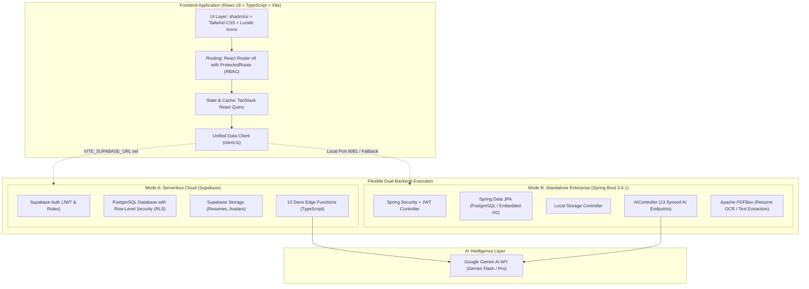

# 🧠 SynapticAI

<p align="center">
  <strong>Next-Generation Evidence-Based AI Hiring & Campus Recruitment Platform</strong>
</p>

<p align="center">
  
  
  
  
  
  
  
  
  
</p>

---

## 📖 Table of Contents
1. [Overview & Vision](#-overview--vision)
2. [Why SynapticAI?](#-why-synapticai)
3. [Portals & Core Capabilities](#-portals--core-capabilities)
   - [🏢 Recruiter Portal](#1--recruiter-portal)
   - [🎓 Student Portal](#2--student-portal)
   - [🛡️ Admin Portal](#3--admin-portal)
   - [📚 Compliance & Educational Resources](#4--compliance--educational-resources)
4. [System Architecture](#-system-architecture)
   - [High-Level Architectural Flow](#high-level-architectural-flow)
   - [Dual-Backend Architecture](#dual-backend-architecture)
5. [AI Intelligence & Edge Functions](#-ai-intelligence--edge-functions)
6. [Repository Structure](#-repository-structure)
7. [Getting Started & Quickstart](#-getting-started--quickstart)
   - [Prerequisites](#prerequisites)
   - [Installation](#installation)
   - [Environment Configuration](#environment-configuration)
   - [Option A: Supabase Cloud / Edge Functions Setup](#option-a-supabase-cloud--edge-functions-setup)
   - [Option B: Java Spring Boot Backend Setup](#option-b-java-spring-boot-backend-setup-local--offline)
   - [Running the Frontend](#running-the-frontend)
8. [Demo Accounts & Seeding](#-demo-accounts--seeding)
9. [Development Scripts](#-development-scripts)
10. [Testing & Quality Assurance](#-testing--quality-assurance)
11. [Ethical AI & Compliance](#-ethical-ai--compliance)
12. [Deployment Guide](#-deployment-guide)
13. [Troubleshooting & FAQ](#-troubleshooting--faq)
14. [License](#-license)

---

## 🌟 Overview & Vision

Traditional recruitment is broken. Recruiters are overwhelmed with thousands of resumes stuffed with keyword buzzwords, while students and candidates struggle to prove their hands-on engineering capabilities. Unconscious bias and unverified claims frequently lead to poor hiring decisions and overlooked talent.

**SynapticAI** replaces keyword-based screening with **Evidence-Based AI Hiring**. By combining real, verified proof from **GitHub**, **LeetCode**, and **LinkedIn** with state-of-the-art **Google Gemini AI models**, SynapticAI creates an objective, transparent, and bias-free hiring ecosystem for campus drives and enterprise recruitment.

```
                  ┌──────────────────────────────────────────────────┐
                  │                 Verified Proof                   │
                  │   GitHub Commits  •  LeetCode Contests  •  Work   │
                  └─────────────────────────┬────────────────────────┘
                                            ▼
                  ┌──────────────────────────────────────────────────┐
                  │            SynapticAI Talent Engine              │
                  │   Explainable Matching • Authenticity Screening  │
                  └─────────────────────────┬────────────────────────┘
                                            ▼
                  ┌──────────────────────────────────────────────────┐
                  │          Fair, Objective Hiring Decision         │
                  │   Ranked Candidates • Gap Analysis • Simulations │
                  └──────────────────────────────────────────────────┘
```

---

## ⚡ Why SynapticAI?

| Metric / Feature | Traditional Resume Screening | SynapticAI Evidence-Based Hiring |
| :--- | :--- | :--- |
| **Primary Evaluation** | Self-claimed keywords in PDF resumes | Verified code on GitHub, problem stats on LeetCode |
| **Transparency** | Black-box ATS keyword filters | **Explainable AI** with line-by-line justification |
| **Authenticity Check** | Manual verification or trust-based | **Automated Forensic AI** detecting inflated metrics & timeline conflicts |
| **Bias Mitigation** | Susceptible to name, gender, & pedigree bias | **Blind Screening Mode** with automated linguistic bias detection |
| **Candidate Experience** | Ghosting, non-actionable rejection emails | **Instant Pre-Application Gap Analysis** & Interactive Mock Simulations |
| **Code Evaluation** | Take-home assignments with manual review | **Automated Project Scoring Engine** inspecting architecture & git hygiene |

---

## 🚀 Portals & Core Capabilities

### 1. 🏢 Recruiter Portal
A mission control dashboard providing hiring teams with deep talent intelligence:
- **AI Job Description Generator (`/recruiter/post-job`)**: Generates comprehensive job descriptions with structured skill tags, experience levels, and responsibilities based on concise hiring prompts.
- **Evidence-Based Candidate Ranking (`/recruiter/jobs/:jobId/candidates`)**: Automatically aggregates candidate signals across GitHub and LeetCode to compute a weighted, explainable match score for each applicant.
- **Resume Authenticity Checker (`/recruiter/authenticity`)**: Detects buzzword stuffing, chronological inconsistencies, and suspicious claim metrics.
- **Automated Project Scoring (`/recruiter/project-scoring`)**: Evaluates candidate GitHub repositories on code cleanliness, architectural modularity, test coverage, and commit frequency.
- **Talent Radar (`/recruiter/talent-radar`)**: Interactive multi-dimensional radar chart visualizing candidate competencies (Frontend, Backend, Algorithms, System Design, DevOps, Teamwork).
- **Talent Discovery (`/recruiter/talent`)**: Semantic candidate search across the student pool with filters for specific technologies, GPA thresholds, and problem counts.
- **Bias Detector (`/recruiter/bias-detector`)**: Audits job requirements and evaluation criteria to highlight non-inclusive language or demographic bias.
- **Recruiter AI Copilot Agent (`/recruiter/agent`)**: Interactive conversational AI assistant capable of answering questions about candidate pipelines, drafting emails, filtering candidates, and suggesting interview questions.
- **Recruiter CRM (`/recruiter/crm`)**: Pipeline stage tracking (Applied, Reviewing, Interviewing, Offer Extended, Hired).
- **Interview Scheduler (`/recruiter/interviews`)**: Coordinates multi-stage technical and behavioral interviews.
- **Analytics Dashboard (`/recruiter/analytics`)**: Funnel drop-off analytics, time-to-hire metrics, diversity tracking, and skill distribution heatmaps.

### 2. 🎓 Student Portal
An empowerment portal helping students navigate campus recruitment with data-driven feedback:
- **Personalized Dashboard (`/student/dashboard`)**: Application progression tracker, interview alerts, profile completion scoring, and tailored job recommendations.
- **AI Profile & Resume Parser (`/student/profile`)**: Instant PDF resume ingestion that parses technical skills, education, projects, and work history into structured profiles.
- **Job Search & Detail View (`/student/jobs`, `/student/jobs/:jobId`)**: Browse openings with detailed skill breakdowns and compensation packages.
- **Instant Eligibility Checker (`/student/jobs/:jobId/eligibility`)**: Evaluates a student's profile against job requirements *before* applying, detailing exact match percentages, strengths, and missing prerequisites.
- **Interactive Interview Simulator (`/student/interview-sim`)**: Dynamic AI interviewer conducting simulated technical and behavioral interviews with real-time feedback on answers.
- **Career Path Roadmap (`/student/career-path`)**: Personalized AI roadmap outlining high-demand skills, certifications, and project ideas to reach target roles.
- **Automated Portfolio Builder (`/student/portfolio`)**: Compiles verified GitHub repositories and achievements into a shareable web portfolio.
- **Application Tracker (`/student/applications`)**: Real-time status updates across all submitted applications.
- **Interviews & Notifications Hub (`/student/interviews`, `/notifications`)**: Centralized alerts for interview dates and recruiter feedback.

### 3. 🛡️ Admin Portal
Platform governance and institutional administration:
- **Admin Dashboard (`/admin/dashboard`)**: System health monitors, active user tracking, student/recruiter profile verifications, and audit logging.
- **Role & Access Governance**: Secure role-based authorization ensuring recruiters, students, and administrators only access permitted resources.

### 4. 📚 Compliance & Educational Resources
- **AI Interviewer Guide (`/resources/ai-interviewer-guide`)**: Best practices and operational frameworks for running ethical, AI-assisted candidate interviews.
- **Bias-Free Hiring Guide (`/resources/bias-free-hiring-guide`)**: Guidelines for creating inclusive job descriptions and objective evaluation rubrics.

---

## 🏗️ System Architecture

SynapticAI features a modern **dual-backend architecture**, allowing flexible deployment in serverless cloud environments (Supabase Cloud) or self-hosted enterprise environments (Java Spring Boot).

### High-Level Architectural Flow



### Dual-Backend Architecture
1. **Serverless Supabase Mode (Default Cloud)**:
   - Utilizes Supabase PostgreSQL, Auth, and Storage.
   - Leverages 13 Deno Edge Functions communicating with Google Gemini AI.
2. **Spring Boot Companion Mode (Local & Enterprise)**:
   - Located in the [`/backend`](file:///c:/Users/manoh/Desktop/synapticai25-main/backend) directory.
   - Built with Java 21, Spring Boot 3.4.1, Spring Data JPA, and Spring Security.
   - Contains an embedded H2 database (or PostgreSQL connection), Apache PDFBox for local resume extraction, and direct Gemini AI integration.
   - `client.ts` automatically proxies calls to `http://localhost:8081` if cloud Supabase credentials are not supplied.

---

## 🤖 AI Intelligence & Edge Functions

SynapticAI includes **13 specialized AI modules** implemented as Deno Edge Functions and mirrored in the Java backend:

| Function / Endpoint | Purpose | Key Inputs & Outputs |
| :--- | :--- | :--- |
| `parse-resume` | Ingests PDF resume documents and parses skills, education, experience, and contact details | **Input**: Base64/PDF file<br>**Output**: Structured candidate profile JSON |
| `rank-candidates` | Multi-signal candidate matching with explainable ranking scores | **Input**: Job requirements + candidate pool<br>**Output**: Sorted candidates with match percentage & breakdown |
| `generate-jd` | Generates structured, professional job descriptions from minimal role specs | **Input**: Role title, industry, experience, tech stack<br>**Output**: Formatted JD with requirements & responsibilities |
| `bias-detect` | Scans job descriptions and candidate evaluations for gendered or exclusionary bias | **Input**: Job posting or review text<br>**Output**: Bias score, detected triggers, suggested revisions |
| `authenticity-check` | Forensic analysis verifying project dates, metrics, and role claims on resumes | **Input**: Resume text & candidate history<br>**Output**: Authenticity index, flagged anomalies |
| `project-score` | Analyzes GitHub repositories for code quality, documentation, test suites, and git hygiene | **Input**: GitHub repository URL<br>**Output**: Code quality score (0-100), architectural assessment |
| `eligibility-check` | Pre-application student eligibility check with real-time match gap analysis | **Input**: Student profile + Job ID<br>**Output**: Match status, missing requirements, recommendations |
| `interview-sim` | Real-time interactive AI interview simulation with streaming responses | **Input**: Role, difficulty, student answer<br>**Output**: Follow-up question, performance critique |
| `recruiter-agent` | Conversational copilot helping recruiters filter candidates and draft outreach | **Input**: Natural language prompt + pipeline context<br>**Output**: Streaming responses and pipeline actions |
| `career-path` | Generates personalized learning paths and career milestones | **Input**: Student skills & target job role<br>**Output**: Skill progression roadmap, suggested projects |
| `portfolio-build` | Generates a clean developer portfolio showcase from GitHub and profile data | **Input**: Student profile + verified projects<br>**Output**: Markdown/HTML portfolio structure |
| `extract-profile` | Extracts structured skill tags and experience from freeform bio or LinkedIn text | **Input**: Unstructured bio text<br>**Output**: Categorized skill tags, years of experience |
| `seed-users` | Seeds database with diverse student profiles, recruiters, jobs, and applications | **Input**: Seed authorization secret<br>**Output**: Database population confirmation |

---

## 📁 Repository Structure

```plaintext
synapticai25-main/
├── .env.example                 # Environment variables template
├── demo_accounts.txt            # Pre-configured demo login credentials
├── package.json                 # Frontend dependencies and scripts
├── vite.config.ts               # Vite configuration with path aliases
├── tailwind.config.ts           # Tailwind CSS design system configuration
├── tsconfig.json                # TypeScript project configuration
├── vercel.json                  # Vercel deployment and routing configuration
│
├── backend/                     # Standalone Java Spring Boot Backend
│   ├── pom.xml                  # Maven configuration (Java 21, Spring Boot 3.4.1)
│   ├── src/main/java/com/sudheeai/backend/
│   │   ├── BackendApplication.java # Spring Boot main entry point
│   │   ├── config/              # Security, CORS, and WebFlux configurations
│   │   ├── controller/          # AIController, AuthController, DbQueryController
│   │   ├── model/               # JPA Entities (User, Job, Candidate, Application)
│   │   ├── repository/          # Spring Data JPA repositories
│   │   ├── security/            # JWT filters, token providers, user details
│   │   └── service/             # AIService (Gemini), DataSeeder
│   └── src/main/resources/
│       └── application.yml      # Spring Boot application properties (H2/Postgres, JWT)
│
├── public/                      # Static assets and favicons
│
├── src/                         # Frontend Application Source Code
│   ├── App.tsx                  # Main router, route definitions, and auth protection
│   ├── index.css                # Global styles, Tailwind directives, glassmorphic tokens
│   ├── main.tsx                 # React application mounting
│   ├── components/              # Reusable UI component library (shadcn/ui + custom)
│   │   ├── ui/                  # Radix UI primitives (dialog, button, table, tabs, toast)
│   │   ├── Navbar.tsx           # Global responsive navigation header
│   │   └── Seo.tsx              # SEO metadata management (react-helmet-async)
│   ├── contexts/                # React Contexts (AuthContext for user state)
│   ├── hooks/                   # Custom React hooks (useToast, useMobile, etc.)
│   ├── integrations/supabase/   # Supabase client proxy and generated database types
│   │   ├── client.ts            # Dynamic dual-mode client (Cloud Supabase / Local Spring Boot)
│   │   └── types.ts             # Complete TypeScript database schema definitions
│   ├── lib/                     # Utility functions (cn, formatters)
│   └── pages/                   # Application views and routes
│       ├── HomePage.tsx         # Landing page highlighting platform capabilities
│       ├── admin/               # Admin Portal (Dashboard, Login)
│       ├── recruiter/           # Recruiter Portal (Ranking, JDs, Authenticity, CRM, Agent)
│       ├── student/             # Student Portal (Dashboard, Simulator, Eligibility, Roadmap)
│       └── resources/           # Educational Guides (AI Interviewer, Bias-Free Hiring)
│
└── supabase/                    # Supabase Infrastructure
    ├── config.toml              # Supabase CLI configuration
    ├── functions/               # 13 Deno Serverless Edge Functions
    │   ├── _shared/             # Shared CORS and Supabase client helpers
    │   ├── authenticity-check/  # Resume verification function
    │   ├── bias-detect/         # Bias audit function
    │   ├── career-path/         # Career roadmap generator
    │   ├── eligibility-check/   # Student-job fit evaluation
    │   ├── interview-sim/       # Interactive interview simulator
    │   ├── rank-candidates/     # Candidate scoring and ranking engine
    │   └── seed-users/          # Database seeding endpoint
    └── migrations/              # 20 PostgreSQL schema migrations & RLS policies
```

---

## 🛠️ Getting Started & Quickstart

### Prerequisites
- **Node.js**: `v18.0.0` or higher
- **npm**: `v9.0.0` or higher
- *(Optional for Java backend)*: **Java Development Kit (JDK) 21** and **Maven 3.9+**
- *(Optional for Supabase Edge deployment)*: **Supabase CLI**

---

### Installation

Clone the repository and install frontend dependencies:

```bash
git clone https://github.com/veeresh0804/synapticai25.git
cd synapticai25-main
npm install
```

> [!TIP]
> **Windows PowerShell Users**: If you encounter `running scripts is disabled on this system`, run PowerShell as Administrator and execute:
> ```powershell
> Set-ExecutionPolicy -Scope Process -ExecutionPolicy Bypass
> ```
> Alternatively, execute npm scripts using Command Prompt (`cmd.exe /c npm install`).

---

### Environment Configuration

Create a `.env` file in the project root by copying the template:

```bash
cp .env.example .env
```

Configure the environment variables based on your setup:

```ini
# Supabase Cloud Configuration (For Cloud Mode)
VITE_SUPABASE_URL=https://your-project-id.supabase.co
VITE_SUPABASE_PUBLISHABLE_KEY=your-supabase-publishable-key
VITE_SUPABASE_PROJECT_ID=your-project-id

# Supabase Server / Edge Configuration
SUPABASE_URL=https://your-project-id.supabase.co
SUPABASE_PUBLISHABLE_KEY=your-supabase-publishable-key
SUPABASE_SECRET_KEY=your-supabase-service-role-key
SUPABASE_JWKS_URL=https://your-project-id.supabase.co/auth/v1/.well-known/jwks.json

# AI Provider Key
AI_PROVIDER_API_KEY=your-gemini-api-key
```

> [!NOTE]
> If you do not configure `VITE_SUPABASE_URL`, the frontend automatically defaults to `http://localhost:8081` to communicate with the included Java Spring Boot backend.

---

### Option A: Supabase Cloud / Edge Functions Setup

1. **Create a Supabase Project**:
   - Go to [Supabase](https://supabase.com) and create a new project.
   - Note your Project URL, anon key, and project reference ID.

2. **Link and Apply Migrations**:
   ```bash
   npx supabase link --project-ref <your-project-ref>
   npx supabase db push
   ```

3. **Configure Edge Function Secrets**:
   ```bash
   npx supabase secrets set AI_PROVIDER_API_KEY=<your-gemini-api-key>
   npx supabase secrets set SEED_SECRET=sb_seed_9f4b1aa86dad4705b8a1a2f7ea38e96a
   ```

4. **Deploy Edge Functions**:
   ```bash
   npx supabase functions deploy
   ```

5. **Populate Demo Data**:
   ```bash
   curl -X POST https://<your-project-ref>.supabase.co/functions/v1/seed-users \
     -H "x-seed-secret: sb_seed_9f4b1aa86dad4705b8a1a2f7ea38e96a"
   ```

---

### Option B: Java Spring Boot Backend Setup (Local / Offline)

You can run the full SynapticAI backend without needing a cloud database using the included Spring Boot backend with embedded H2 storage:

1. **Navigate to the backend folder**:
   ```bash
   cd backend
   ```

2. **Configure AI Key (Optional for AI functions)**:
   Set your Gemini API key in your environment:
   ```bash
   # Linux/macOS
   export AI_PROVIDER_API_KEY=your-gemini-key

   # Windows PowerShell
   $env:AI_PROVIDER_API_KEY="your-gemini-key"
   ```

3. **Run with Maven**:
   ```bash
   mvn spring-boot:run
   ```
   *The backend starts at `http://localhost:8081` and automatically seeds initial demo data into the embedded database.*

---

### Running the Frontend

Start the Vite development server:

```bash
npm run dev
```

Open your browser and navigate to: **`http://localhost:8080`** (or the port displayed in your terminal).

---

## 👥 Demo Accounts & Seeding

The application comes with comprehensive pre-seeded accounts across all three user tiers.

> [!IMPORTANT]
> **Universal Password for ALL Demo Accounts**: `Demo@1234`

### 👨‍🎓 Student Accounts (Mock Resumes, Applications & Verified Signals)
| Candidate Name | Email | Institution / Profile |
| :--- | :--- | :--- |
| **Garima Rajput** | `garima.rajput21@goa.iitb.ac.in` | IIT Goa — Full Stack & Systems |
| **Nikhil Mishra** | `nikhil.mishra20@jammu.iitb.ac.in` | IIT Jammu — Competitive Coding |
| **Pavan Bose** | `pavan.bose22@hyderabad.iitb.ac.in` | IIT Hyderabad — AI / Data Science |
| **Rishabh Choudhary** | `rishabh.choudhary23@bhilai.iitb.ac.in` | IIT Bhilai — Backend & Cloud |
| **Deepika Kapoor** | `deepika.kapoor24@student.university.ac.in` | University Student — Frontend / React |

### 👔 Recruiter Accounts (Active Jobs, Candidate Pools & CRM)
| Recruiter Name | Email | Company Representation |
| :--- | :--- | :--- |
| **Myra Kapoor** | `myra.kapoor@tcs.com` | Tata Consultancy Services (TCS) |
| **Suresh Verma** | `suresh.verma@infosys.com` | Infosys |
| **Tara Jain** | `tara.jain@google.com` | Google India |
| **Namita Kulkarni** | `namita.kulkarni@microsoft.com` | Microsoft India |
| **Dhruv Kulkarni** | `dhruv.kulkarni@amazon.com` | Amazon India |
| **Harsh Roy** | `harsh.roy@flipkart.com` | Flipkart |
| **Shubham Das** | `shubham.das@razorpay.com` | Razorpay |

### 🛠️ Administrator Account
| Role | Email | Capabilities |
| :--- | :--- | :--- |
| **System Administrator** | `admin@hirehub.com` | Platform oversight, audit logs, user management |

---

## 💻 Development Scripts

| Command | Action |
| :--- | :--- |
| `npm run dev` | Starts the Vite development server with Hot Module Replacement (HMR) |
| `npm run build` | Builds the production-optimized frontend bundle into `dist/` |
| `npm run preview` | Locally previews the production build |
| `npm run lint` | Runs ESLint 9 to detect code quality and styling issues |
| `npm run test` | Executes unit and component tests using Vitest |
| `npm run test:watch`| Runs Vitest in interactive watch mode |

---

## 🧪 Testing & Quality Assurance

SynapticAI uses **Vitest** paired with **React Testing Library** and **JSDOM** for fast, reliable unit and integration tests.

```bash
# Run tests once
npm test

# Run tests in watch mode
npm run test:watch
```

Test coverage includes:
- Authentication state preservation and redirection
- Component rendering and state changes
- Role-based route guard integrity (`ProtectedRoute`)
- AI payload transformation utilities

---

## ⚖️ Ethical AI & Compliance

SynapticAI is built from the ground up to support fair and transparent hiring practices:

1. **Explainable Recommendations (XAI)**:
   - No opaque rejection scores. Each ranking presents clear, itemized criteria (e.g., algorithmic proficiency, specific framework depth, practical project experience).
2. **Blind Evaluation Mode**:
   - Anonymizes candidate names, photos, gender markers, and institutional tiers during initial scoring passes.
3. **Automated Linguistic Bias Detection**:
   - Analyzes job postings for gender-coded terms (e.g., hyper-aggressive phrasing) and exclusionary requirements.
4. **Data Privacy & Row-Level Security (RLS)**:
   - Multi-tenant data segregation enforced through PostgreSQL RLS policies, ensuring students only view their own applications and recruiters access authorized applicant pools.

---

## 🚢 Deployment Guide

### Deploying the Frontend (Vercel)
The repository includes a pre-configured [`vercel.json`](file:///c:/Users/manoh/Desktop/synapticai25-main/vercel.json) supporting Single Page Application (SPA) routing:

1. Import the repository into your **Vercel** dashboard.
2. Under **Environment Variables**, add:
   - `VITE_SUPABASE_URL`
   - `VITE_SUPABASE_PUBLISHABLE_KEY`
   - `VITE_SUPABASE_PROJECT_ID`
3. Deploy! Vercel automatically runs `npm run build` and serves the output from `dist`.

### Deploying Supabase Edge Functions
```bash
npx supabase functions deploy --all
```

---

## ❓ Troubleshooting & FAQ

<details>
<summary><strong>Q: Why does the app say "Failed to fetch" or show mock data?</strong></summary>
If <code>VITE_SUPABASE_URL</code> is not configured or points to a non-existent instance, the application switches to its local fallback proxy expecting the Java Spring Boot backend at <code>http://localhost:8081</code>. Either start the Spring Boot backend or supply valid Supabase project credentials in <code>.env</code>.
</details>

<details>
<summary><strong>Q: How do I resolve PowerShell execution policy errors on Windows?</strong></summary>
Execute in PowerShell:
<pre><code>Set-ExecutionPolicy -Scope Process -ExecutionPolicy Bypass</code></pre>
Or run commands via Command Prompt (<code>cmd.exe /c npm run dev</code>).
</details>

<details>
<summary><strong>Q: Can I use SynapticAI without a Gemini API key?</strong></summary>
Yes. The platform's UI, job listings, application workflows, CRM, and analytics work with mock data. A Gemini API key (<code>AI_PROVIDER_API_KEY</code>) is only required for live dynamic AI generations (e.g., generating new JDs or real-time mock interview dialogues).
</details>

---

## 📄 License

This project is licensed under the **MIT License** — see the [LICENSE](LICENSE) file for details.

---

<p align="center">
  Built with ❤️ for fairer, proof-backed campus and enterprise recruitment.
</p>
